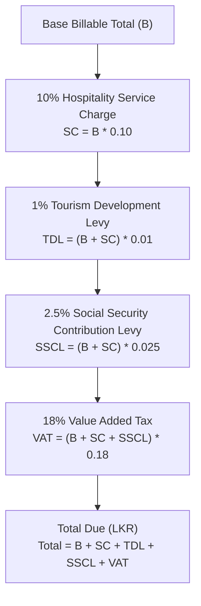

# Sri Lanka Cloud SaaS HMS — Flutter & Dart Mobile Integration Contract

## 1. Executive Summary & Purpose

This contract establishes the formal architectural, cryptographic, and networking specification for integrating upcoming **Flutter / Dart cross-platform mobile applications** into the Sri Lanka Cloud SaaS Hotel Management System (HMS).

The mobile subsystem encompasses four primary personas:
1. **Contactless Guest Room Service Mobile App & PWA**: Zero-login QR room ordering, Central Bank LankaQR EMVCo payments, and live order tracking.
2. **Staff Kitchen Display System (KDS) & Bar BOT**: Smartphone and tablet kitchen dispatch with trilingual order itemization (`English / සිංහල / தமிழ்`).
3. **Waiter Mobile Tabletop POS**: Table ordering, split bills, and LankaQR / WebXPay dynamic invoice settlement.
4. **Housekeeping Runner**: Mobile room turnover checklist, minibar consumption logging, and linen replenishment.

All communications connect directly to the AWS AppSync GraphQL API in `ap-south-1` (Mumbai) with direct AppSync JS DynamoDB resolvers (`APPSYNC_JS_1_0_0`) executing in sub-10ms without Lambda cold starts.

---

## 2. Multi-Tenant DynamoDB Partition Contract

Every mobile request must enforce the single-table SaaS partition boundary:
- **Tenant Partition Key**: `PK = TENANT#<tenantId>`
- **Sort Key Partitioning**:
  - `ROOM#<roomNumber>`: Room inventory, features, and housekeeping state.
  - `GUEST#<guestId>`: Guest profile (with PDPA Section 14 anonymization compliance).
  - `FOLIO#<folioId>`: Guest stay billing, sub-folios, and compounding statutory tax ledgers.
  - `ORDER#<orderId>`: KDS kitchen and bar tickets.
  - `TAX_RECORD#<period>`: IRD and SLTDA monthly VAT/TDL tax summaries.
  - `AUDIT#<isoTimestamp>`: Deterministic SHA-256 hash-chained `ImmutableAuditLog`.

Cross-tenant data access is strictly blocked at the AppSync resolver layer via `tenantGuard(ctx)`:
```javascript
// AppSync JS Resolver Tenant Guard
if (ctx.identity.claims['custom:tenantId'] !== requestedTenantId) {
  util.unauthorized();
}
```

---

## 3. Authentication & Authorization Protocols

### 3.1 Staff Mobile Client: Amazon Cognito User Pools
Staff applications (KDS, Waiter POS, Housekeeping Runner, GM Portal) authenticate via Amazon Cognito User Pools:
- **AWS Region**: `ap-south-1` (Mumbai)
- **Auth Flow**: `USER_SRP_AUTH` (Secure Remote Password)
- **Token Format**: Standard OIDC JWTs (`id_token`, `access_token`, `refresh_token`).
- **Token Claims**:
  - `sub`: Unique Cognito User UUID (`usr-...`)
  - `custom:tenantId`: Assigned hotel tenant identifier (e.g. `tenant-colombo-grand`)
  - `custom:hotelRole`: Staff role mapped to `RolePermissionMatrix`:
    - `SUPER_ADMIN`, `HOTEL_OWNER`, `GENERAL_MANAGER`, `FRONT_DESK_AGENT`
    - `EXECUTIVE_CHEF`, `LINE_COOK`, `FNB_CASHIER`, `BARTENDER`
    - `HOUSEKEEPING_SUPERVISOR`, `HOUSEKEEPING_ATTENDANT`, `MAINTENANCE_ENGINEER`

#### Silent Token Refresh Loop in Flutter
Cognito ID tokens expire after 60 minutes. The Flutter mobile client must implement silent token renewal at minute 55:
```dart
import 'package:amplify_flutter/amplify_flutter.dart';

Future<String> getValidAuthToken() async {
  final session = await Amplify.Auth.fetchAuthSession();
  if (session.isSignedIn) {
    final cognitoSession = session as CognitoAuthSession;
    return cognitoSession.userPoolTokensResult.value.idToken.raw;
  }
  throw Exception('Session expired; re-authenticate with credentials');
}
```

---

### 3.2 Contactless Guest QR Mobile Client: Deep-Link HMAC Authentication
Guests do **not** register or enter passwords. Access is established by scanning physical in-room continuous squircle acrylic NFC / QR stands.

#### Deep-Link URL Scheme
```
slhms://qr/:tenantId/:locationId?t=<hmacSha256>&ts=<unixTimestamp>
```
Example:
```
slhms://qr/tenant-colombo-grand/ROOM_104?t=9a2f7c4e5b8d1a3f6e8b2c4d7e9f1a3b5c7d9e1f3a5b7c9d1e3f5a7b9c1d3e5f&ts=1729519200
```

#### Guest Request Headers
- **Public Catalog Queries** (`listMenuCatalog`, `getMenuItem`):
  Authenticated using the tenant's AppSync API Key passed via `x-api-key`.
- **Order Placement Mutations** (`createServiceOrder`):
  Signed by the guest client including:
  ```http
  x-tenant-id: tenant-colombo-grand
  x-location-id: ROOM_104
  x-guest-hmac-token: 9a2f7c4e5b8d1a3f6e8b2c4d7e9f1a3b5c7d9e1f3a5b7c9d1e3f5a7b9c1d3e5f
  x-timestamp: 1729519200
  ```

---

## 4. AppSync Real-Time WebSocket Protocol & Headers

AWS AppSync real-time subscriptions use the `graphql-ws` subprotocol over secure WebSockets.

### 4.1 Connection URLs
- **Standard GraphQL HTTP**:
  `https://<api-id>.appsync-api.ap-south-1.amazonaws.com/graphql`
- **Real-Time WebSocket**:
  `wss://<api-id>.appsync-realtime-api.ap-south-1.amazonaws.com/graphql`

---

### 4.2 Handshake Authentication Headers
The WebSocket connection URL requires two base64-encoded query parameters:
1. `header`:
   ```json
   {
     "host": "<api-id>.appsync-api.ap-south-1.amazonaws.com",
     "Authorization": "Bearer <CognitoJwtIdToken>"
   }
   ```
2. `payload`: `{}` (empty JSON object).

In Dart / Flutter:
```dart
import 'dart:convert';

String buildWebSocketUrl(String apiId, String region, String jwtToken) {
  final host = '$apiId.appsync-api.$region.amazonaws.com';
  final rawHeader = jsonEncode({
    'host': host,
    'Authorization': 'Bearer $jwtToken',
  });
  final encodedHeader = base64Url.encode(utf8.encode(rawHeader));
  final encodedPayload = base64Url.encode(utf8.encode('{}'));

  return 'wss://$apiId.appsync-realtime-api.$region.amazonaws.com/graphql?header=$encodedHeader&payload=$encodedPayload';
}
```

---

### 4.3 WebSocket Message Framing Lifecycle

#### Step 1: Initialize Connection
Client sends:
```json
{
  "type": "connection_init"
}
```
Server responds:
```json
{
  "type": "connection_ack",
  "payload": {
    "connectionTimeoutMs": 300000
  }
}
```

#### Step 2: Keep-Alive Heartbeat
Server transmits periodic keep-alive pings every 30 seconds:
```json
{
  "type": "ka"
}
```
Client ignores or uses this to verify the socket is alive.

#### Step 3: Register Subscription
Client subscribes to kitchen orders:
```json
{
  "id": "sub_orders_kds_01",
  "type": "start",
  "payload": {
    "data": "{\"query\":\"subscription OnServiceOrderCreated($tenantId: ID!) { onServiceOrderCreated(tenantId: $tenantId) { id orderNumber orderStatus roomNumber totalAmountLkr items { name quantity } } }\",\"variables\":{\"tenantId\":\"tenant-colombo-grand\"}}",
    "extensions": {
      "authorization": {
        "Authorization": "Bearer <CognitoJwtIdToken>",
        "host": "<api-id>.appsync-api.ap-south-1.amazonaws.com"
      }
    }
  }
}
```
Server acknowledges:
```json
{
  "type": "start_ack",
  "id": "sub_orders_kds_01"
}
```

#### Step 4: Stream Real-Time Events
When a guest places an order, AppSync pushes:
```json
{
  "type": "data",
  "id": "sub_orders_kds_01",
  "payload": {
    "data": {
      "onServiceOrderCreated": {
        "id": "ord-20261021-0012",
        "orderNumber": "KDS-0012",
        "orderStatus": "PREPARING",
        "roomNumber": "104",
        "totalAmountLkr": 4850.50,
        "items": [
          { "name": "Kottu Roti (Chicken Special)", "quantity": 2 },
          { "name": "Ceylon Black Tea & Milk", "quantity": 2 }
        ]
      }
    }
  }
}
```

#### Step 5: Unsubscribe & Teardown
```json
{
  "type": "stop",
  "id": "sub_orders_kds_01"
}
```

---

## 5. Sri Lankan Statutory Tax Calculation Engine (Mobile Standard)

All monetary amounts displayed in the Flutter UI must follow Sri Lankan Inland Revenue Act No. 24 of 2017 & Tourism Act No. 38 of 2005 rules:



### Dart Pure Function Implementation
```dart
class SriLankanTaxBreakdown {
  final double baseAmountLkr;
  final double serviceChargeLkr;
  final double tdlLkr;
  final double ssclLkr;
  final double vatLkr;
  final double totalDueLkr;

  const SriLankanTaxBreakdown({
    required this.baseAmountLkr,
    required this.serviceChargeLkr,
    required this.tdlLkr,
    required this.ssclLkr,
    required this.vatLkr,
    required this.totalDueLkr,
  });

  static double roundCents(double value) {
    return (value * 100).roundToDouble() / 100;
  }

  factory SriLankanTaxBreakdown.compute(double baseLkr) {
    final b = roundCents(baseLkr);
    final sc = roundCents(b * 0.10);
    final subtotalWithSc = roundCents(b + sc);
    final tdl = roundCents(subtotalWithSc * 0.01);
    final sscl = roundCents(subtotalWithSc * 0.025);
    final vatBasis = roundCents(subtotalWithSc + sscl);
    final vat = roundCents(vatBasis * 0.18);
    final total = roundCents(b + sc + tdl + sscl + vat);

    return SriLankanTaxBreakdown(
      baseAmountLkr: b,
      serviceChargeLkr: sc,
      tdlLkr: tdl,
      ssclLkr: sscl,
      vatLkr: vat,
      totalDueLkr: total,
    );
  }
}
```

---

## 6. Offline Resiliency & Queueing in Mobile Clients

Sri Lankan resort environments (Ella hills, Sigiriya jungle, Yala buffer zone) often experience intermittent 4G/5G mobile connectivity.

The Flutter mobile app must adopt the following resilience standards:
1. **Local Persistent Cache**: Cache `ListMenuCatalog` and active room lists locally using SQLite / Hive.
2. **Optimistic UI Updates**: KDS ticket completion and housekeeping dirty/clean state transitions mutate local state immediately.
3. **Outbox Synchronization Queue**: Pending mutations (`createServiceOrder`, `updateRoomHousekeepingStatus`) write to a persistent outbox queue and flush with exponential backoff on reconnection:
   - Initial retry: 1s
   - Max retry interval: 30s
   - Jitter: $\pm 20\%$

---

## 7. Mobile UI Design System Standard (Apple HIG Grounded)

All Flutter widgets must adhere to the design system specified in `.agents/skills/apple-design/SKILL.md`:
- **Liquid Glass Translucency**: `BackdropFilter` with `sigmaX: 24, sigmaY: 24`, 72% opacity white (light mode) / 74% opacity `#1C1C1E` (dark mode).
- **Typography**: SF Pro Text / Display with tabular numerals (`FontFeature.tabularFigures()`) across all LKR and USD currency displays.
- **Continuous Squircle Geometry**: `ContinuousRectangleBorder` with radius `16-24`.
- **Minimum Touch Targets**: All interactive elements `>= 44 x 44 pt`.
- **Haptic Physics**: Immediate `HapticFeedback.lightImpact()` on button tap and order submission.
